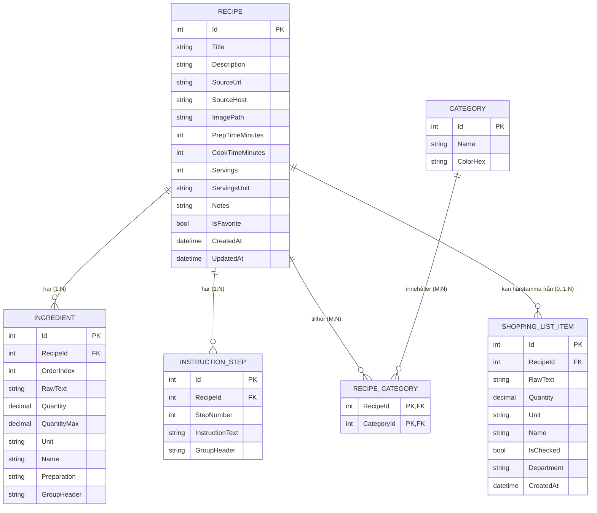
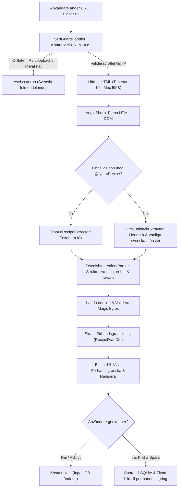
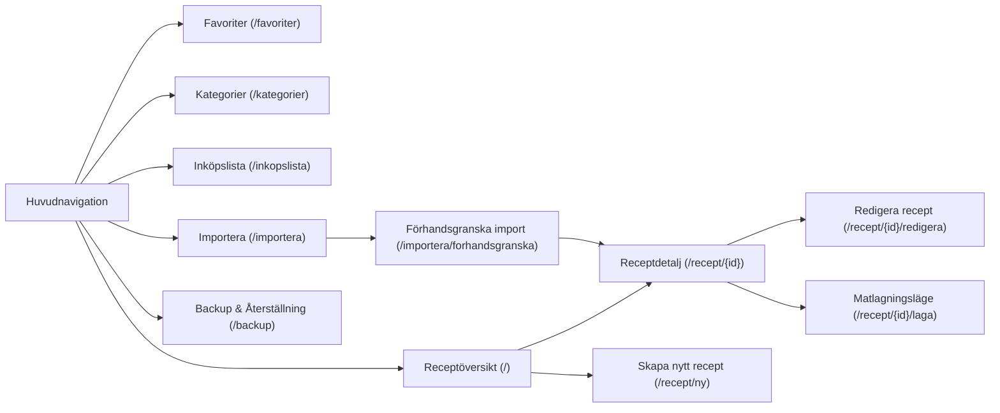
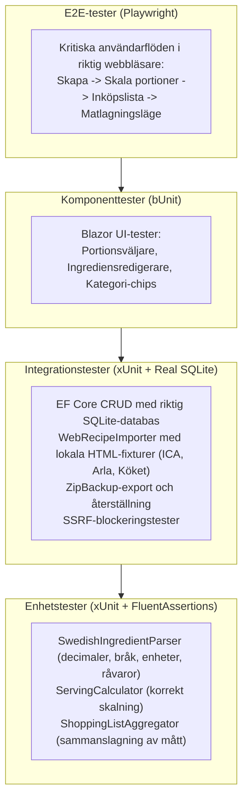

# Receptbanken — Arkitektur och Teknisk Specifikation

## 1. Systemöversikt

**Receptbanken** är en komplett, självhostad webbapplikation för personlig recepthantering. Applikationen är utvecklad från grunden i **C# och .NET 10 LTS** med **Blazor Web App (Interactive Server)** och **Microsoft Fluent UI Blazor**, backad av **SQLite** via **Entity Framework Core**.

Systemet är optimerat för ett modernt, betrott hemnätverk (t.ex. på en Ubuntu Linux-hemserver via Docker), kräver inga externa databasservrar, inga molnabonnemang och **inga externa AI-tjänster**. All receptimport, ingredienstolkning och portionsberäkning sker helt deterministiskt och lokalt.

> [!IMPORTANT]
> **Säkerhetsförutsättning och Nätverksisolering:**
> Applikationen har medvetet ingen inbyggd autentisering då den är designad för ett betrott hemnätverk. Den **får inte exponeras direkt mot det publika internet** utan en autentiserande omvänd proxy (t.ex. Cloudflare Tunnel / Zero Trust, Authelia eller Tailscale).

```mermaid
graph TD
    subgraph Klient ["Webbläsare (Mobil, Surfplatta, Desktop)"]
        UI["Blazor Interactive Server UI<br/>(Fluent UI + Mörkt Kulinariskt Tema)"]
        JS["JS Interop<br/>(Screen Wake Lock för Matlagningsläge)"]
    end

    subgraph AppHost ["ASP.NET Core Web Host (.NET 10 LTS)"]
        SignalR["SignalR Circuit (Antiforgery-skyddad)"]
        subgraph WebLayer ["Receptbanken.Web"]
            Pages["Blazor Pages & Components"]
            Services["UI Services & Notifieringar"]
        end
        subgraph CoreLayer ["Receptbanken.Core"]
            Domain["Domänmodeller (Recipe, Ingredient, Step, m.fl.)"]
            Parser["Svensk Ingredienstolk & Portionsberäknare"]
            Aggregator["Inköpsliste-aggregering"]
        end
        subgraph InfraLayer ["Receptbanken.Infrastructure"]
            Importer["Receptimportör (AngleSharp, JSON-LD)"]
            Ssrf["Stärkt SSRF-skydd (DNS Rebinding, IPv4-mapped IPv6)"]
            FileStorage["Lokal Bildlagring & Validering"]
            Backup["Transaktionell Zip Backup & Återställning (Zip Bomb-skydd)"]
            EF["IDbContextFactory<AppDbContext> (Kortlivade contexts)"]
        end
    end

    subgraph Storage ["Persistenta Docker-volymer (/app/data)"]
        DB[(receptbanken.db<br/>SQLite WAL-läge)]
        Images["/app/data/images/<br/>Receptbilder (.webp)"]
        Backups["/app/data/backups/<br/>Exporterade .zip-arkiv"]
    end

    UI <-->|SignalR WebSocket| SignalR
    SignalR --> Pages
    Pages --> Services
    Pages --> CoreLayer
    Pages --> InfraLayer
    InfraLayer --> EF
    InfraLayer --> FileStorage
    InfraLayer --> Backup
    Importer --> Ssrf
    EF --> DB
    FileStorage --> Images
    Backup --> Backups
    Ssrf -.->|Säker HTTP GET (SSRF-skyddad)| ExternalWeb["Receptwebbplatser & Bildservrar<br/>(ICA, Arla, Köket, etc.)"]
```

---

## 2. Teknologistack & Motivering

| Komponent | Vald teknologi | Motivering & Roll |
| :--- | :--- | :--- |
| **Plattform** | .NET 10 LTS (`net10.0`) | Den senaste LTS-versionen av .NET. Utmärkt prestanda, C# 13/14, långsiktig support och tillförlitlig containerkörning på Linux. |
| **Backend & Web Framework** | ASP.NET Core Blazor Web App | Typad helhetslösning i C#. Ger direkt integration mellan UI, domänlogik och databas utan behov av REST-API-overhead eller duplicerade DTO-lager för interna vyer. |
| **Renderingsläge** | Blazor Interactive Server | Ger omedelbar tvåvägsbindning, snabb serverside-bearbetning för filuppladdning och webbskrapning, samt noll exponering av interna hemligheter mot klienten. |
| **Databasanslutning** | `IDbContextFactory<AppDbContext>` | **Kritiskt val för Blazor Server**: Undviker delade, långlivade Scoped DbContext-instanser i SignalR-kretsar. Skapar kortlivade `DbContext`-instanser per operation för att eliminera samtidighetsproblem och minnesläckor. |
| **Komponentbibliotek** | Microsoft Fluent UI Blazor (`v4.x`) | Robusta, tillgängliga (a11y), tangentbordsvänliga grundkomponenter för formulär, dialoger, menyer och knappar. |
| **Visuell Design & Tema** | Skräddarsydd mörk CSS ("Dark Culinary Theme") | Ersätter standard enterprise-utseende med mörk antracitgrå bakgrund (`#121214`), varma kulinariska accenter (`#e07a5f` / `#f2a65a`), generösa bildkort och tydlig typografi. |
| **Databas** | SQLite 3 | Självinnesluten, filbaserad databas med noll administration. Körs med Write-Ahead Logging (WAL) och Foreign Keys aktiverade. |
| **ORM & Migreringar** | Entity Framework Core SQLite | Starkt typade entiteter, LINQ-frågor, kontrollerade schema-migreringar (`dotnet ef migrations`). **Inga onödiga generiska repository-abstraktioner**; direkta, fokuserade applikationstjänster med LINQ. |
| **HTML- & DOM-parsning** | AngleSharp | Extremt snabb, standardföljande C# HTML5-parser utan externa beroenden (ingen WebKit/Chromium-overhead). |
| **Strukturerad Data** | `System.Text.Json` | Högpresterande JSON-deserialisering för Schema.org Recipe JSON-LD och säkerhetskopior. |
| **Bildhantering** | SixLabors.ImageSharp | Plattforms-oberoende C#-bildbearbetning för omskalning, EXIF-strippning och WebP-konvertering. |
| **Testning** | xUnit, FluentAssertions, bUnit, Playwright | Omfattande enhets-, integrations- och end-to-end-tester med riktiga SQLite-databaser och lokala HTML-fixturer. |
| **Körningsmiljö** | Docker & Docker Compose | Multi-stage Linux-container med dedikerade volymer för databas och bilder. |

---

## 3. Lösnings- och Projektstruktur

För att hålla arkitekturen pragmatisk och fri från onödig abstraktion (såsom generiska repositorier över EF Core) struktureras koden i **tre kärnprojekt** och **två testprojekt**:

```
Receptbanken/
├── Receptbanken.sln
├── Dockerfile
├── docker-compose.yml
├── ARCHITECTURE.md
├── PROJECT_PLAN.md
├── README.md
├── src/
│   ├── Receptbanken.Core/                  # Domänmodeller, enums, affärsregler, svensk tolk
│   │   ├── Models/                         # Recipe, Ingredient, InstructionStep, Category, ShoppingListItem
│   │   ├── Enums/                          # UnitType, ImportSource
│   │   ├── Services/
│   │   │   ├── SwedishIngredientParser.cs  # Regex- & token-baserad tolk för svenska mått & ingredienser
│   │   │   ├── ServingCalculator.cs        # Proportionell portionsskalning
│   │   │   └── ShoppingListAggregator.cs   # Sammanfogning av kompatibla ingredienser
│   │   └── Interfaces/                     # IImageStorageService, IRecipeImporter, IBackupService
│   │
│   ├── Receptbanken.Infrastructure/        # EF Core, databas, lagring, webbskrapning, backup
│   │   ├── Data/
│   │   │   ├── AppDbContext.cs             # EF Core DbContext med SQLite-konfiguration
│   │   │   └── Configurations/             # EntityTypeConfigurations (fluent mapping)
│   │   ├── Services/
│   │   │   ├── RecipeService.cs            # Pragmatiska CRUD-operationer via IDbContextFactory
│   │   │   ├── CategoryService.cs          # Kategorihantering via IDbContextFactory
│   │   │   └── ShoppingListService.cs      # Inköpslistetjänst via IDbContextFactory
│   │   ├── Migrations/                     # EF Core schema-migreringar
│   │   ├── Storage/
│   │   │   ├── LocalImageStorageService.cs # Sparar bilder på disk, validerar magic bytes & storlek
│   │   │   └── PathSanitizer.cs            # Säkerhetskontroller mot Path Traversal (Zip Slip)
│   │   ├── Importers/
│   │   │   ├── WebRecipeImporter.cs        # Huvudorkestrator för URL-import
│   │   │   ├── JsonLdRecipeExtractor.cs    # Extraherar Schema.org/Recipe från ld+json
│   │   │   ├── HtmlFallbackExtractor.cs    # Reserv-extraherare för vanliga svenska sajter (ICA, Arla m.fl.)
│   │   │   └── SsrfGuardHandler.cs         # SocketsHttpHandler med ConnectCallback & DNS-rebind-skydd
│   │   └── Backup/
│   │       └── ZipBackupService.cs         # Transaktionell backup med filsystemsåterställning & limits
│   │
│   └── Receptbanken.Web/                   # Blazor Web App (Interactive Server), UI & Routing
│       ├── Components/
│       │   ├── Layout/                     # MainLayout.razor, NavMenu.razor, AppHeader.razor
│       │   ├── Recipes/                    # RecipeCard.razor, RecipeGrid.razor, ServingAdjuster.razor,
│       │   │                               # IngredientEditor.razor, InstructionEditor.razor
│       │   ├── Import/                     # ImportUrlForm.razor, ImportPreviewModal.razor
│       │   ├── Cooking/                    # CookingModeView.razor, IngredientDrawer.razor, StepTimer.razor
│       │   ├── Shopping/                   # ShoppingListTable.razor, AddRecipeToShoppingModal.razor
│       │   └── Common/                     # ConfirmDialog.razor, CategoryBadge.razor, ImageUpload.razor
│       ├── Pages/                          # Dashboard (/), ReceptDetalj (/recept/{id}),
│       │                                   # NyttRecept (/recept/ny), RedigeraRecept (/recept/{id}/redigera),
│       │                                   # Importera (/importera), Kategorier (/kategorier),
│       │                                   # Favoriter (/favoriter), Inkopslista (/inkopslista),
│       │                                   # Matlagningslage (/recept/{id}/laga), Backup (/backup)
│       ├── Services/                       # WebNotificationService.cs, BrowserWakeLockService.cs
│       ├── wwwroot/
│       │   ├── css/
│       │   │   ├── app.css                 # Huvudstilmall, CSS-variabler, Dark Culinary Theme
│       │   │   └── cooking-mode.css        # Specifik styling för matlagningsläge
│       │   └── js/
│       │       └── cooking-helper.js       # WakeLock API & fullskärmskontroll
│       ├── Program.cs                      # Service-registrering (IDbContextFactory), middleware, CSRF
│       └── appsettings.json                # Konfiguration (datasökvägar, storleksgränser)
│
└── tests/
    ├── Receptbanken.Tests/                 # Enhets- och integrationstester
    │   ├── Core/                           # Tester för SwedishIngredientParser, ServingCalculator, m.fl.
    │   ├── Infrastructure/                 # EF Core SQLite-tester, ZipBackup transaktionstest, SSRF-tester
    │   ├── Fixtures/                       # Sparade HTML/JSON-LD-fixturer (ICA, Arla, Köket, Tasteline)
    │   └── Components/                     # bUnit-komponenttester för Blazor UI
    └── Receptbanken.E2E/                   # Playwright webbläsartester för kritiska användarflöden
```

---

## 4. Databasdesign & EF Core SQLite-schema

Databasen är normaliserad och relationell. Alla relationer, index och kaskadbeteenden konfigureras explicit via Fluent API i `AppDbContext`.

### `IDbContextFactory<AppDbContext>` i Blazor Server
För att förhindra de välkända problemen med delad tillståndshantering och samtidighet i Blazor Server registreras databaskontexten med:
```csharp
services.AddDbContextFactory<AppDbContext>(options =>
    options.UseSqlite(connectionString));
```
Alla applikationstjänster injicerar `IDbContextFactory<AppDbContext>` och öppnar kortlivade instanser:
```csharp
await using var context = await _contextFactory.CreateDbContextAsync();
return await context.Recipes
    .AsNoTracking()
    .Include(r => r.RecipeCategories)
    .ThenInclude(rc => rc.Category)
    .ToListAsync();
```
Detta eliminerar risken för:
1. `InvalidOperationException: A second operation was started on this context instance before a previous operation completed.`
2. Minnesläckor från långlivade change-trackers i SignalR-kretsen.
3. Inaktuell cache-data när flera användare eller flikar är öppna.



---

## 5. Receptimport & Stärkt SSRF-skydd

Importen är helt **deterministisk, säker och fri från AI-beroenden**. Både HTML-inläsning och bildnedladdning passerar genom samma förstärkta säkerhetsfilter.

### Förstärkt SSRF-försvar (`SsrfGuardHandler`)
För att förhindra Server-Side Request Forgery och skydda användarens lokala nätverk implementeras följande skyddsmekanismer i anpassad `SocketsHttpHandler`:

1. **DNS Rebinding & TOCTOU-skydd**:
   - Genom att använda `ConnectCallback` valideras IP-adressen precis i det ögonblick då TCP-socketen skapas, och anslutningen görs **direkt** till den validerade IP-adressen. Detta eliminerar Time-of-Check to Time-of-Use (DNS Rebinding) helt.
2. **IPv4-Mapped IPv6-skydd**:
   - IPv6-adresser kontrolleras med `ip.IsIPv4MappedToIPv6`. Om så är fallet konverteras adressen via `ip.MapToIPv4()` och testas mot alla IPv4-blockregler.
3. **Omfattande IP-blocklista**:
   - **Loopback**: `127.0.0.0/8`, `::1`
   - **Privata nätverk (RFC 1918)**: `10.0.0.0/8`, `172.16.0.0/12`, `192.168.0.0/16`
   - **Unika lokala IPv6**: `fc00::/7`, `fd00::/8`
   - **Länk-lokala adresser**: `169.254.0.0/16`, `fe80::/10`
   - **Carrier-Grade NAT (RFC 6598)**: `100.64.0.0/10`
   - **Moln-metadata**: `169.254.169.254`
   - **Multicast / Broadcast**: `224.0.0.0/4`, `255.255.255.255`, `ff00::/8`
   - **Odefinierade / noll-adresser**: `0.0.0.0`, `::`
4. **Strikt Redirect-validering**:
   - Automatisk omdirigering stängs av (`AllowAutoRedirect = false`).
   - Varje HTTP-omdirigering (301, 302, 307, 308) hanteras i kod. Den nya URL:en granskas genom exakt samma SSRF-validering före nästa anrop. Kedjan begränsas till maximalt 5 hopp.
5. **Skydd även för Receptbilder**:
   - När en receptbild laddas ner från en extern URL används **samma SSRF-skyddade HttpClient**. Data-URI:er, `file://`-scheman och interna adresser avvisas.

---

## 6. Säkerhetskopiering med Transaktionell Filsystemsåterställning & Resursgränser

Säkerhetskopiering skapar ett portabelt `.zip`-arkiv innehållande `manifest.json`, `data.json` och bildkatalogen `images/`.

### Resursgränser (Zip Bomb & Resursutmattning)
För att förhindra Zip Bomb-attacker och DoS vid uppackning tillämpas strikta gränser:
- **Maximal arkivstorlek (komprimerad)**: 100 MB.
- **Maximal dekomprimerad totalstorlek**: 500 MB (summeras löpande under uppackning; avbryts direkt om gränsen överskrids).
- **Maximalt antal filer**: 5 000 filer.
- **Maximal storlek för enskild fil**: 50 MB.
- **Zip-Slip-skydd**: Varje uppackad filväg valideras med `Path.GetFullPath` för att garantera att den inte kan skrivas utanför målmappen.

### Återställningsstrategi: DB-transaktion + Filsystemsrollback
Återställning garanterar atomicitet över både databasen och filsystemet:
1. Extrahera arkivet till en isolerad temporär katalog (`/app/data/temp/restore_{guid}/`).
2. Validera manifest, schemaversion och filbegränsningar.
3. Skapa en temporär skuggkopia av befintlig `receptbanken.db` samt befintlig `images/`-katalog (`/app/data/temp/backup_pre_restore_{guid}/`).
4. Öppna en EF Core-databastransaktion (`await using var transaction = await context.Database.BeginTransactionAsync()`).
5. Utför databasuppdateringarna (ersätt eller slå ihop).
6. Vid framgångsrik databasuppdatering:
   - Kopiera in de nya bilderna till den aktiva `/app/data/images/`-katalogen.
   - Committa databastransaktionen (`await transaction.CommitAsync()`).
   - Rensa de temporära arbetskatalogerna.
7. **Vid minsta fel (databasfel eller filsystemfel)**:
   - Rulla tillbaka databastransaktionen (`await transaction.RollbackAsync()`).
   - Återställ filsystemets `images/` från skuggkopian om filer hann ändras.
   - Radera temporära filer.
   - Visa ett tydligt svenskt felmeddelande för användaren — systemet förblir i sitt ursprungliga intakta tillstånd.

---

## 7. CSRF-skydd och Webbsäkerhet

1. **CSRF i Blazor Interactive Server**:
   - SignalR-kretsen etableras över en WebSocket med kryptografiskt signerad kretsidentifiering och ASP.NET Cores inbyggda antiforgery-skydd vid handshake.
   - Alla HTTP POST-formulär (såsom filuppladdning och backup-återställning) skyddas med `AntiforgeryMiddleware` och validerade antiforgery-tokens.
2. **XSS-skydd**:
   - All användardata HTML-encodas automatiskt av Blazor vid rendering.
   - AngleSharp används strikt som DOM-läsare för `TextContent` — skriptexekvering är helt inaktiverad.
3. **Säker Filuppladdning**:
   - Magic Bytes-validering (JPEG, PNG, WebP).
   - Generering av unika UUID-filnamn (`{guid}.webp`) förhindrar manipulering av filsystemet.


### Detaljerad tabellspecifikation

#### 1. `Recipes` (Recept)
- `Id` (`INTEGER`, Primary Key, Autoincrement)
- `Title` (`TEXT`, Not Null, max 200 tecken) — Indexerad för sökning.
- `Description` (`TEXT`, Nullable) — Fritextbeskrivning.
- `SourceUrl` (`TEXT`, Nullable, max 2000 tecken) — Ursprunglig URL vid import eller länk.
- `SourceHost` (`TEXT`, Nullable, max 100 tecken) — T.ex. "ica.se" för snabbfiltrering/visning.
- `ImagePath` (`TEXT`, Nullable, max 500 tecken) — Relativ sökväg till lagrad bildfil (`images/recipes/{guid}.webp`).
- `PrepTimeMinutes` (`INTEGER`, Nullable) — Förberedelsetid i minuter.
- `CookTimeMinutes` (`INTEGER`, Nullable) — Tillagningstid i minuter.
- `Servings` (`INTEGER`, Not Null, Default 4) — Basantal portioner.
- `ServingsUnit` (`TEXT`, Not Null, Default 'portioner', max 50 tecken).
- `Notes` (`TEXT`, Nullable) — Egna kockanteckningar och tips.
- `IsFavorite` (`INTEGER/BOOLEAN`, Not Null, Default 0) — Indexerad för omedelbar favoritfiltrering.
- `CreatedAt` (`TEXT/DATETIME`, Not Null) — Skapad tidsstämpel (UTC).
- `UpdatedAt` (`TEXT/DATETIME`, Not Null) — Senast uppdaterad (UTC).

#### 2. `Ingredients` (Ingredienser)
- `Id` (`INTEGER`, Primary Key, Autoincrement)
- `RecipeId` (`INTEGER`, Foreign Key -> `Recipes.Id`, On Delete CASCADE, Not Null)
- `OrderIndex` (`INTEGER`, Not Null) — Ordning i listan.
- `RawText` (`TEXT`, Not Null) — Ursprunglig text (t.ex. "1,5 dl vispgrädde, lätt vispad"). Bevaras alltid oförändrad!
- `Quantity` (`REAL/DECIMAL`, Nullable) — Tolkat decimaltal (t.ex. 1.5).
- `QuantityMax` (`REAL/DECIMAL`, Nullable) — För intervall (t.ex. 2 i "1-2 klyftor").
- `Unit` (`TEXT`, Nullable, max 30 tecken) — Tolkad enhet (t.ex. "dl", "msk", "g").
- `Name` (`TEXT`, Not Null, max 200 tecken) — Tolkad råvarubenämning (t.ex. "vispgrädde").
- `Preparation` (`TEXT`, Nullable, max 200 tecken) — T.ex. "finhackad", "smält".
- `GroupHeader` (`TEXT`, Nullable, max 100 tecken) — Valfri rubrik för uppdelning (t.ex. "Pannkakssmet", "Sås").

#### 3. `InstructionSteps` (Instruktionssteg)
- `Id` (`INTEGER`, Primary Key, Autoincrement)
- `RecipeId` (`INTEGER`, Foreign Key -> `Recipes.Id`, On Delete CASCADE, Not Null)
- `StepNumber` (`INTEGER`, Not Null) — Stegnummer (1, 2, 3...).
- `InstructionText` (`TEXT`, Not Null) — Instruktionstext.
- `GroupHeader` (`TEXT`, Nullable, max 100 tecken) — Valfri rubrik (t.ex. "Förberedelser", "Montering").

#### 4. `Categories` (Kategorier)
- `Id` (`INTEGER`, Primary Key, Autoincrement)
- `Name` (`TEXT`, Not Null, Unikt Index, max 100 tecken) — T.ex. "Vardagsmat", "Pasta", "Bakning".
- `ColorHex` (`TEXT`, Nullable, max 9 tecken) — Hex-färgkod för taggvisning (t.ex. `#e07a5f`).

#### 5. `RecipeCategories` (Kopplingstabell M:N)
- `RecipeId` (`INTEGER`, Foreign Key -> `Recipes.Id`, On Delete CASCADE)
- `CategoryId` (`INTEGER`, Foreign Key -> `Categories.Id`, On Delete CASCADE)
- Primärnyckel: `(RecipeId, CategoryId)`

#### 6. `ShoppingListItems` (Inköpslisteartiklar)
- `Id` (`INTEGER`, Primary Key, Autoincrement)
- `RecipeId` (`INTEGER`, Foreign Key -> `Recipes.Id`, On Delete SET NULL, Nullable)
- `RawText` (`TEXT`, Not Null) — Artikelbeskrivning.
- `Quantity` (`REAL/DECIMAL`, Nullable) — Kvantitet vid aggregering.
- `Unit` (`TEXT`, Nullable, max 30 tecken) — Enhet.
- `Name` (`TEXT`, Not Null, max 200 tecken) — Råvarunamn.
- `IsChecked` (`INTEGER/BOOLEAN`, Not Null, Default 0) — Avbockad status i affären.
- `Department` (`TEXT`, Nullable, max 100 tecken) — Butiksavdelning (t.ex. "Mejeri", "Frukt & Grönt").
- `CreatedAt` (`TEXT/DATETIME`, Not Null)

---

## 5. Receptimport & Svensk Tolkningspipeline

Importen är helt **deterministisk, säker och fri från AI-beroenden**.



### 1. SSRF-skydd (`SsrfGuardHandler`)
För att förhindra Server-Side Request Forgery mot användarens hemnätverk (t.ex. router, NAS, smarta hem-enheter):
- Endast `http` och `https` tillåts som protokoll.
- Värddatorns DNS slås upp innan socket-anslutning.
- Varje IP-adress kontrolleras mot en blocklista:
  - `IPAddress.IsLoopback` (`127.0.0.0/8`, `::1`)
  - Privata nätverk (RFC 1918: `10.0.0.0/8`, `172.16.0.0/12`, `192.168.0.0/16`)
  - Link-Local (`169.254.0.0/16`, `fe80::/10`)
  - Moln-metadata IP-adresser (`169.254.169.254`)
  - Broadcast och multicast (`224.0.0.0/4`, `255.255.255.255`)
- HTTP-omdirigeringar (Redirects) följs inte blint: varje hopp i kedjan valideras genom samma SSRF-kontroll.
- Max svarsstorlek begränsas till 5 MB och timeout sätts till 10 sekunder.

### 2. JSON-LD Extraktion (`JsonLdRecipeExtractor`)
De allra flesta receptsajter (inklusive ICA, Arla, Köket.se, Tasteline, BBC Good Food m.fl.) implementerar **Schema.org Recipe** för att synas i Googles sökresultat:
- Söker igenom alla `<script type="application/ld+json">`.
- Hanterar både direkta objekt och samlingar i `@graph`.
- Mappar standardfält:
  - `name` -> Titel
  - `description` -> Beskrivning
  - `image` -> Bild-URL (avläser strängar, arrayer eller `ImageObject`)
  - `recipeYield` -> Portionsantal (extraherar siffror ur "4 portioner", "6 st" etc.)
  - `cookTime`, `prepTime`, `totalTime` -> ISO 8601-durationer (t.ex. `PT25M` -> 25 min)
  - `recipeIngredient` -> Råa ingrediensrader
  - `recipeInstructions` -> Stegvis instruktionstext (hanterar `HowToStep`, `HowToSection` och enkla textsträngar)

### 3. Svensk Fallback-extraktion (`HtmlFallbackExtractor`)
Om JSON-LD saknas:
- Söker efter OpenGraph-taggar (`og:title`, `og:description`, `og:image`).
- Använder kurerade välkända selektorer för svenska matsajter (t.ex. klasser som `.recipe-ingredients`, `.recept-steg`, `ul.ingredients`).

### 4. Svensk Ingredienstolk (`SwedishIngredientParser`)
En dedikerad parser specialiserad på svenska receptformat:
- **Talsystem & Bråk**:
  - Decimaler med kommatecken: `1,5` -> `1.5`, `0,75` -> `0.75`
  - Unicode-bråktal: `½` -> `0.5`, `¼` -> `0.25`, `¾` -> `0.75`
  - Blandade bråk: `1 ½` -> `1.5`, `2 1/4` -> `2.25`
  - Intervall: `1-2` -> `Quantity = 1, QuantityMax = 2`
  - Cirka-angivelser: `ca 400 g` -> `Quantity = 400`
- **Svenska Enheter**:
  - Volym: `dl`, `msk`, `tsk`, `krm`, `l`, `cl`, `ml`
  - Vikt: `g`, `kg`, `hg`
  - Styck/Förpackning: `st`, `klyfta`/`klyftor`, `kruka`/`krukor`, `burk`/`burkar`, `förp`, `påse`, `paket`, `skiva`/`skivor`, `nypa`, `blad`, `kvist`/`kvistar`
- **Separering av råvara och beredning**:
  - `RawText`: "1,5 dl vispgrädde, lätt vispad"
  - `Quantity`: 1.5
  - `Unit`: "dl"
  - `Name`: "vispgrädde"
  - `Preparation`: "lätt vispad"
- **Säkerhetsprincip**: Om en rad är tvetydig (t.ex. "salt och peppar efter smak") sparas hela texten i `RawText` och `Name`, utan att hitta på felaktiga mängder eller enheter.

### 5. Strikt användargodkännande
Ett importerat recept sparas **aldrig automatiskt**. Användaren presenteras alltid för en förhandsgranskningsvy där alla fält, tider, ingredienser och steg kan justeras innan ett aktivt klick på **"Spara recept"** genomför lagringen i SQLite.

---

## 6. UI/UX-arkitektur & Designsystem

Applikationen designas med ett **"Dark Culinary Theme"** inspirerat av moderna matlagningsappar och exklusiva kokböcker:
- Mörk antracitgrå bakgrund som lyfter fram matfotografier.
- Varm terrakotta/bärnstensfärgad accentfärg (`#e07a5f` / `#d97706`).
- Tydlig typografi med god kontrast (WCAG AA-godkänd) och stora klickytor anpassade för fingrar med mjöl på i köket.
- Alla texter och gränssnittselement är på **svenska**.

### Färgpalett
```css
:root {
  --rb-bg-base: #121214;        /* Huvudbakgrund */
  --rb-bg-surface: #18181b;     /* Yta för kort och paneler */
  --rb-bg-elevated: #27272a;    /* Dialoger och hovring */
  --rb-border: #3f3f46;         /* Diskreta avgränsare */
  --rb-text-primary: #fafafa;   /* Högkontrast rubriker och brödtext */
  --rb-text-secondary: #a1a1aa; /* Sekundär text, metadata */
  --rb-text-muted: #71717a;     /* Inaktiva element, platshållare */
  --rb-accent: #e07a5f;         /* Varm terrakotta - primära knappar/ikoner */
  --rb-accent-hover: #e76f51;   /* Hover-tillstånd */
  --rb-accent-gold: #f2a65a;    /* Stjärnor/favoriter och tidsikoner */
  --rb-success: #10b981;        /* Klart, avbockat, framgång */
  --rb-danger: #ef4444;         /* Radera, felmeddelanden */
}
```

### Huvudvyer & Navigationsstruktur



1. **Receptöversikt (`/`)**:
   - Stor responsiv rutnätsvy med bildrika kort (`RecipeCard`).
   - Sökfält i realtid (söker över titel, beskrivning, ingredienser och kategorier).
   - Kategori-chips för snabb filtrering (möjlighet att välja flera).
   - Sorteringsväljare (Senast skapade, Favoriter, Snabbast tillagningstid, Bokstavsordning).
2. **Receptdetalj (`/recept/{id}`)**:
   - Hero-bild i toppklass, titel, ursprungslänk och metadata-brickor (tid, kategorier, källa).
   - Dynamisk portionsväljare (`- / +`) som omedelbart skalar ingrediensmängderna i realtid.
   - Interaktiv ingredienslista med klickbara kryssrutor (för att bocka av under förberedelse).
   - Steg-för-steg-instruktioner.
   - Snabba åtgärdsknappar: "Starta matlagningsläge", "Lägg till i inköpslista", "Redigera", "Favoritmarkera".
3. **Skapa & Redigera recept (`/recept/ny`, `/recept/{id}/redigera`)**:
   - Strukturerat formulär byggt med Fluent UI-komponenter (`FluentTextField`, `FluentTextArea`, `FluentNumberField`).
   - Drag-och-släpp eller ordningsjustering för ingrediensrader och instruktionssteg.
   - Möjlighet att lägga till grupprubriker (t.ex. "Pajdeg", "Fyllning").
   - Bildväljare med lokal filuppladdning och omedelbar förhandsvisning.
4. **Importera från länk (`/importera`) & Förhandsgranskning (`/importera/forhandsgranska`)**:
   - Klistra in receptlänk, klicka på "Hämta recept".
   - Tydlig laddningsindikator (`FluentProgressRing`).
   - Redigerbar förhandsgranskning där användaren kontrollerar tolkningen och väljer kategorier innan receptet sparas.
5. **Matlagningsläge (`/recept/{id}/laga`)**:
   - Distraktionsfritt fullskärmsgränssnitt optimerat för mobil och surfplatta på köksbänken.
   - Visar **ett instruktionssteg i taget** med extra stor och lättläst text.
   - Stora "Föregående" och "Nästa"-knappar.
   - Visuell framstegsindikator (Steg X av Y).
   - Utdragbar sidopanel (`Drawer`) för snabb åtkomst till ingredienserna utan att lämna steget.
   - **Screen Wake Lock API**: Håller enhetens skärm tänd automatiskt så att den inte slocknar medan man har kladdiga händer.
6. **Inköpslista (`/inkopslista`)**:
   - Samlar råvaror från valda recept (med angivet portionsantal) och manuella tillägg.
   - Automatisk summering av kompatibla mått (t.ex. 2 dl mjölk + 3 dl mjölk = 5 dl mjölk).
   - Avbockning i butik med enkel sortering och knapp för "Rensa avbockade artiklar".
7. **Säkerhetskopiering & Återställning (`/backup`)**:
   - Generering och nedladdning av komplett zip-arkiv (databasdata + bilder).
   - Dra-och-släpp-återställning med valideringsrapport innan databasen uppdateras.

---

## 7. Säkerhetsarkitektur

Eftersom applikationen är avsedd för hemnätverk utan traditionell inloggning implementeras strikt försvarsdjup för att skydda systemet och hemnätverket:

1. **SSRF-försvar (Server-Side Request Forgery)**:
   - Anpassad `SocketsHttpHandler` blockerar anrop till loopback (`127.0.0.1`, `::1`), RFC 1918-nät (`10.0.0.0/8`, `172.16.0.0/12`, `192.168.0.0/16`), länk-lokala adresser och molnmetadata.
   - Både initial anslutning och alla omdirigeringssteg valideras strikt.
2. **Filuppladdningsskydd**:
   - Tillåtna filändelser: endast `.jpg`, `.jpeg`, `.png`, `.webp`.
   - Magic Bytes-validering (filinnehållet kontrolleras för riktiga bildhuvuden, oberoende av filnamn).
   - Max filstorlek: 10 MB per bild.
   - Filer sparas aldrig under användarens originalnamn utan tilldelas slumpmässiga UUID:n (`{guid}.webp`) för att förhindra Path Traversal och exekveringsrisker.
3. **Skydd mot Zip Slip (Path Traversal vid Backup-återställning)**:
   - Vid uppackning av säkerhetskopior kontrolleras varje filväg i zip-arkivet mot målmappens kanoniska sökväg (`Path.GetFullPath`). Filer utanför målmappen avvisas omedelbart.
4. **XSS-skydd (Cross-Site Scripting)**:
   - Blazor encodar all text som standard vid rendering.
   - AngleSharp används enbart för att läsa ut textinnehåll (`TextContent`) ur specifika HTML-noder — inga skript körs någonsin.

---

## 8. Backup & Återställningsformat

Säkerhetskopiering skapar ett portabelt `.zip`-arkiv som kan flyttas mellan servrar:

```
receptbanken-backup-2026-10-25.zip
├── manifest.json       # Metadata om exporten
├── data.json           # Komplett relationsdata (recept, ingredienser, steg, kategorier)
└── images/             # Alla bildfiler som refereras i databasen
    ├── abc12345.webp
    └── def67890.webp
```

### `manifest.json` Exempel
```json
{
  "version": "1.0",
  "exportedAt": "2026-10-25T12:00:00Z",
  "recipeCount": 42,
  "categoryCount": 8,
  "imageCount": 38,
  "appVersion": "1.0.0"
}
```

Vid återställning körs processen inom en **databas-transaktion**:
1. Validera zip-filens struktur och `manifest.json`.
2. Packa upp bilder till en temporär katalog och verifiera filernas integritet.
3. Importera kategorier och recept i databasen.
4. Om allt lyckas: committa transaktionen och flytta bilderna till den permanenta bildkatalogen. Om något felar: rulla tillbaka transaktionen utan att påverka befintlig data.

---

## 9. Docker & Persistent Datalagring

Applikationen körs i en slimmad multi-stage Linux-container baserad på Microsofts officiella .NET 8 runtime-avbildningar.

### Dataisolering & Volymmontering
För att garantera att **inga användardata, recept eller bilder försvinner** vid container-uppdateringar monteras hela `/app/data` externt:

```yaml
version: '3.8'

services:
  receptbanken:
    image: receptbanken:latest
    build:
      context: .
      dockerfile: Dockerfile
    container_name: receptbanken
    restart: unless-stopped
    ports:
      - "8080:8080"
    environment:
      - ASPNETCORE_ENVIRONMENT=Production
      - ASPNETCORE_URLS=http://+:8080
      - Storage__DataPath=/app/data
    volumes:
      - receptbanken-data:/app/data

volumes:
  receptbanken-data:
    driver: local
```

Inom `/app/data` skapas automatiskt följande struktur:
- `/app/data/receptbanken.db` — SQLite-databasfilen.
- `/app/data/images/` — Sparade receptbilder.
- `/app/data/backups/` — Exporterade säkerhetskopior.

Vid uppgradering (`docker compose pull && docker compose up -d`) ersätts enbart applikationsbinärerna. EF Core kör automatiskt eventuella nya databasmigreringar vid uppstart, och all befintlig data förblir intakt.

---

## 10. Teststrategi & Kvalitetssäkring

Projektet tillämpar en pyramid av automatiserade tester som körs helt utan externa eller betalda tjänster:



- **Enhetstester**:
  - `SwedishIngredientParserTests`: Verifierar alla tänkbara svenska mått, bråktal (`1 ½`, `½`), kommatecken (`1,5 dl`), sammansatta ingredienser och parenteser.
  - `ServingCalculatorTests`: Verifierar skalning från t.ex. 4 till 6 portioner och säkerställer att icke-numeriska rader ("salt och peppar") inte förvanskas.
  - `ShoppingListAggregatorTests`: Verifierar att "2 dl mjölk" + "3 dl mjölk" blir "5 dl mjölk", medan inkompatibla mått behålls som separata rader.
- **Integrationstester med riktig SQLite**:
  - Tester körs mot en verklig SQLite-instans (i temp-katalog eller med delad minnesanslutning) för att garantera att relationer, kaskadborttagningar och SQLite-specifik SQL fungerar identiskt med produktionsmiljön.
- **Import-tester med lokala fixturer**:
  - Sparade HTML- och JSON-LD-filer från svenska receptsajter sparas i testprojektet under `Fixtures/`. Inga skarpa webbanrop görs under testerna, vilket gör dem 100 % tillförlitliga och oberoende av nätverk.
- **SSRF-säkerhetstester**:
  - Testar att anrop mot `http://127.0.0.1`, `http://localhost`, `http://192.168.1.1` och `http://169.254.169.254` fångas upp och blockeras med ett informativt felmeddelande.
- **bUnit-tester**:
  - Testar isolerade Blazor-komponenter för att säkerställa korrekt tvåvägsbindning och händelsehantering.
- **Playwright E2E-tester**:
  - Verifierar slutanvändarflödet: Skapa recept -> Visa detaljvy -> Starta matlagningsläge.

---

## 11. Tekniska Risker & Åtgärdsplan

| Risk | Sannolikhet / Påverkan | Förebyggande åtgärd & Arkitektonisk lösning |
| :--- | :--- | :--- |
| **Ändrad HTML-struktur på receptsajter** | Medel / Medel | Förlita sig primärt på standardiserad Schema.org JSON-LD som webbplatser sällan ändrar eftersom deras Google-rankning beror på den. **Obligatorisk förhandsgranskning och manuell redigering** före sparning säkerställer att användaren alltid har sista ordet. |
| **SSRF-attacker via URL-import** | Medel / Hög | Anpassad `SocketsHttpHandler` med IP-validering mot loopback, lokala subnät och moln-metadata på anslutningsnivå före varje HTTP-förfrågan och vid varje omdirigering. |
| **Dataförlust vid container-uppdatering** | Låg / Kritisk | Dedikerad extern volymmontering för `/app/data` (`receptbanken.db` och `images/`). Databasen ligger aldrig i containerns tillfälliga filsystem. Automatiska EF Core-migreringar vid start. |
| **Generisk "Enterprise"-känsla i UI** | Hög / Medel | Skräddarsydd mörk CSS ("Dark Culinary Theme") med varma terrakotta- och bärnstensdetaljer, mjuka skuggor, rundade hörn, och generöst med bildutrymme som döljer Fluent UI:s typiska kontorsestetik. |
| **Skärmen slocknar under matlagning** | Hög / Medel | Implementering av Screen Wake Lock API via Blazor JS Interop i matlagningsläget, så att surfplattan eller telefonen hålls vaken automatiskt. |
| **Komplexa eller ostandardiserade mått** | Medel / Låg | Konservativ ingredienstolkning. Om mått eller enhet inte med säkerhet kan identifieras sparas hela texten som råsträng utan att hitta på felaktiga värden. |

