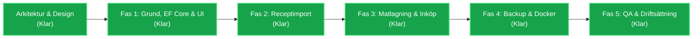

# Receptbanken — Projektplan & Genomförandestrategi

Denna projektplan beskriver implementationen av **Receptbanken**, en modern självhostad recepthanterare i **C# / .NET 10 LTS**, **Blazor Web App (Interactive Server)** med `IDbContextFactory`, **Fluent UI Blazor** och **SQLite**.

> [!IMPORTANT]
> **Säkerhetsförutsättning:** Applikationen har medvetet ingen inbyggd autentisering då den är konstruerad för enbart ett betrott lokalt hemnätverk (LAN/VLAN) eller bakom en autentiserande omvänd proxy. Den får inte exponeras direkt mot det publika internet.

> **Aktuell status:** 🟢 *Samtliga faser (Fas 1–5) är implementerade och verifierade på .NET 10 LTS (`net10.0`).*

---

## Översikt över faser

---

## Detaljerade genomförandesteg

### Fas 1 — Grundstruktur, Datamodell & Recepthantering
**Mål:** Etablera lösning, databaslager med EF Core SQLite via `IDbContextFactory<AppDbContext>`, pragmatiska tjänster utan onödiga generiska repositorier, webbgränssnitt med Fluent UI och det mörka kulinariska temat, samt fullständig CRUD för recept och kategorier.

- [x] **1.1 Lösningsstruktur & Projektkonfiguration**
  - [x] Skapa `Receptbanken.sln` och projekten `Receptbanken.Core`, `Receptbanken.Infrastructure`, `Receptbanken.Web`, `Receptbanken.Tests`.
  - [x] Konfigurera målsystem (`.NET 10 LTS` / `net10.0`), C# 13/14, nullable reference types och implicita usings.
  - [x] Installera stabila NuGet-paket (`Microsoft.FluentUI.AspNetCore.Components`, `Microsoft.EntityFrameworkCore.Sqlite`, `SixLabors.ImageSharp`, m.fl.).
- [x] **1.2 Domänmodeller & EF Core SQLite med IDbContextFactory**
  - [x] Definiera domänentiteter: `Recipe`, `Ingredient`, `InstructionStep`, `Category`, `RecipeCategory`, `ShoppingListItem`.
  - [x] Skapa `AppDbContext` med Fluent API-konfigurationer (index, begränsningar, kaskadregler, `DateTimeOffset` till UTC-ticks converter).
  - [x] Konfigurera `IDbContextFactory<AppDbContext>` för kortlivade databaskontexter i Blazor Server.
  - [x] Konfigurera SQLite med WAL-läge (`PRAGMA journal_mode=WAL;`) och utländska nycklar.
  - [x] Skapa pragmatiska domäntjänster (`RecipeService`, `CategoryService`) utan onödiga generiska repositorier.
  - [x] Skapa och tillämpa initial EF Core-migrering (`InitialCreate`).
- [x] **1.3 Visuell Design & Fluent UI Anpassning**
  - [x] Etablera Dark Culinary Theme i `app.css` med anpassade CSS-variabler för bakgrunder (`#121214`), ytor (`#18181b`) och varma accenter (`#e07a5f`).
  - [x] Bygga `MainLayout`, `AppHeader` och responsiv sidonavigation.
  - [x] Skapa återanvändbara UI-komponenter (`RecipeCard`, `CategoryBadge`, `ConfirmDialog`, `ServingAdjuster`).
- [x] **1.4 Recept- och Kategorihantering (CRUD)**
  - [x] Implementera receptöversikt (Dashboard) med bildkort, filter-chips och tomma-lägen.
  - [x] Implementera receptdetaljvy med stor bild, ingredienslista och steg.
  - [x] Implementera formulär för skapa/redigera recept med dynamiska ingrediensrader och instruktionssteg.
  - [x] Implementera kategorihantering (skapa, redigera, radera med bekräftelse, tilldela till recept).
  - [x] Implementera sök- och filtreringsfunktion (fritextsökning på titel/beskrivning/ingredienser kombinerat med kategorival).
- [x] **1.5 Bildhantering (Lokal lagring)**
  - [x] Implementera `LocalImageStorageService` för validering av filtyp (magic bytes), filstorlek och konvertering/optimering till WebP.
  - [x] Hantera bildbyte och radering av oanvända bildfiler från disk.
- [x] **1.6 Tester för Fas 1**
  - [x] Enhetstester och bUnit-komponenttester.
  - [x] Integrationstester med riktig SQLite-databas, EF Core-migreringar och `IDbContextFactory` för CRUD och M:N-relationer.
  - [x] Valideringstester för bilduppladdning och format.

---

### Fas 2 — Receptimport från Webbplatser
**Mål:** Skapa en deterministisk, säker importmotor som extraherar recept från svenska och internationella webbplatser utan externa AI-tjänster, med strikt SSRF-skydd och obligatorisk användargranskning.

- [x] **2.1 Förstärkt SSRF-skydd (`SsrfGuardHandler`)**
  - [x] Implementera `ConnectCallback`-baserad socketanslutning för att eliminera DNS Rebinding (TOCTOU).
  - [x] Validera mot IPv4-mapped IPv6, RFC 1918-adresser, loopback, CGNAT och moln-metadata.
  - [x] Validera IP-adresser vid varje omdirigering i HTTP-kedjan (manuell redirect-hantering, max 5 hopp).
  - [x] Tillämpa samma SSRF-skyddade klient för nedladdning av externa receptbilder.
  - [x] Sätt strikta tidsgränser (10 sekunder) och maxgräns för svarsstorlek (5 MB).
- [x] **2.2 Strukturerad Extraktion (AngleSharp & JSON-LD)**
  - [x] Implementera `JsonLdRecipeExtractor` för Schema.org Recipe (stöd för både enstaka objekt och `@graph`).
  - [x] Tolka ISO 8601-tidsformat (`PT30M`), portionsangivelser och instruktionsstrukturer (`HowToStep`, `HowToSection`).
- [x] **2.3 Reserv-extrahering (HTML Fallback)**
  - [x] Implementera `HtmlFallbackExtractor` för webbplatser utan Schema.org-data.
  - [x] Kurerade selektorer för vanliga svenska källor (ICA, Arla, Köket.se, Tasteline, Coop).
- [x] **2.4 Svensk Ingredienstolk (`SwedishIngredientParser`)**
  - [x] Tolka bråk (`½`, `¼`, `¾`, `1 ½`), decimaler med kommatecken (`1,5`), intervall (`1-2`).
  - [x] Identifiera svenska måttenheter (`dl`, `msk`, `tsk`, `krm`, `g`, `kg`, `st`, `klyftor`, `burkar` m.fl.).
  - [x] Extrahera råvarunamn och förberedelseanteckningar separat.
- [x] **2.5 Bildhämtning vid Import**
  - [x] Ladda ner fjärrbild via SSRF-skyddad pipeline, validera format och spara lokalt. Ingen beroende av externa bildlänkar efter sparning.
- [x] **2.6 Förhandsgransknings- och Godkännandevy**
  - [x] Bygga `/importera` och redigerbar förhandsvisning i `/importera/forhandsgranska`.
  - [x] Säkerställa att recept **aldrig** sparas i databasen förrän användaren aktivt klickar på "Spara recept".
- [x] **2.7 Tester för Fas 2**
  - [x] SSRF-säkerhetstester (blockering av 127.0.0.1, ::ffff:127.0.0.1, 192.168.x.x, 169.254.x.x och loopback-redirects).
  - [x] Parser-tester mot sparade lokala HTML-fixturer för ICA, Arla, Köket.se och Tasteline.
  - [x] Enhetstester för alla svenska mått- och bråkkombinationer.

---

### Fas 3 — Matlagningsfunktioner & Inköpslista
**Mål:** Leverera funktioner som gör applikationen oumbärlig i köket och vid mathandling.

- [x] **3.1 Favoriter & Snabbsortering**
  - [x] Markera/avmarkera favoriter med ett klick.
  - [x] Dedikerad vy `/favoriter` samt filter i dashboard.
- [x] **3.2 Dynamisk Portionsberäkning**
  - [x] Implementera `ServingCalculator` som skalar kvantiteter säkert och proportionellt.
  - [x] Interaktiv portionsväljare (`- / +`) i receptdetaljvyn med omedelbar omräkning i UI.
  - [x] Bevara originaltext för icke-numeriska rader.
- [x] **3.3 Inköpslista**
  - [x] Datamodell för `ShoppingListItem` och `ShoppingListService`.
  - [x] Stöd för att lägga till ingredienser från ett recept (med valfritt antal portioner).
  - [x] `ShoppingListAggregator`: intelligent sammanslagning av samma ingrediens med kompatibla mått.
  - [x] Vy `/inkopslista`: avbockning under shopping, manuella tillägg, redigering och rensning av avbockade varor.
- [x] **3.4 Matlagningsläge (Cooking Mode)**
  - [x] Fullskärmsläge optimerat för mobil och surfplatta på köksbänken (`/recept/{id}/laga`).
  - [x] Visning av **ett steg i taget** med extra stor text.
  - [x] Framstegsindikator, stora navigationsknappar (Föregående / Nästa).
  - [x] Utdragbar sidopanel för receptets ingredienslista med avbockningsstöd.
  - [x] Screen Wake Lock API via Blazor JS Interop så att skärmen inte slocknar under matlagning.
- [x] **3.5 Tester för Fas 3**
  - [x] Enhetstester för portionsberäkning och avrundning.
  - [x] Enhetstester för inköpslisteaggregering och `ShoppingListService`.
  - [x] bUnit-tester för komponenterna i matlagningsläget.

---

### Fas 4 — Säkerhetskopiering & Docker-driftsättning
**Mål:** Säkerställa portabilitet, datasäkerhet och enkel driftsättning på en personlig Ubuntu Linux-hemserver.

- [x] **4.1 Transaktionell Backup & Återställning (ZIP-arkiv)**
  - [x] Implementera `ZipBackupService` med gränser mot Zip Bomb: max 100 MB komprimerat, max 500 MB dekomprimerat, max 5 000 filer.
  - [x] Path Traversal-skydd (Zip Slip-kontroll vid uppackning).
  - [x] Atomär återställning: EF Core-transaktion kombinerat med temporär skuggkopia av `images/` för fullständig rollback vid minsta fel.
  - [x] Antiforgery-skydd (CSRF) på uppladdning av säkerhetskopior.
  - [x] Nedladdnings- och uppladdningsgränssnitt under `/backup` samt `/api/backup/export`.
- [x] **4.2 Dockerfile & Multi-stage Build**
  - [x] Skriva slimmad, säker Dockerfile baserad på officiella .NET 10 SDK- och ASP.NET-avbildningar.
  - [x] Körning under icke-root användare (`app`).
- [x] **4.3 Docker Compose & Volymkonfiguration**
  - [x] Skapa `docker-compose.yml` med persistent volym för `/app/data`.
  - [x] Dokumentera att databas och bilder aldrig försvinner vid container-omstarter eller uppgraderingar.
- [x] **4.4 Tester för Fas 4**
  - [x] Integrationstest för export -> rensa databas -> återställning -> verifiera data och bilder.
  - [x] Transaktionstest: Verifiera att databas och filsystem återställs exakt om ett fel uppstår mitt i återställningen.
  - [x] Säkerhetstest för skadliga zip-filer med `../`-sökvägar och för stora dekomprimerade filer.

---

### Fas 5 — Kvalitetssäkring, Integration & Slutverifiering
**Mål:** Validera hela applikationen, granska tillgänglighet, responsivitet och sammanställa fullständig dokumentation.

- [x] **5.1 Automatiserade Integrations- och Flödestester**
  - [x] Flöde 1: Skapa recept manuellt -> Ändra portioner -> Lägg i inköpslista -> Verifiera.
  - [x] Flöde 2: Simulera import -> Förhandsgranska -> Redigera -> Spara -> Verifiera.
  - [x] Flöde 3: Matlagningsläge och stegstegring.
  - [x] Flöde 4: Backup-export, återställning och rollback-validering.
  - [x] Fullständiga ASP.NET Core `WebApplicationFactory<Program>`-tester mot alla vyer och API-endpoints.
- [x] **5.2 Verifiering & Responsivitet**
  - [x] Responsiv layout på mobil, surfplatta och desktop.
  - [x] Alla texter i gränssnittet är på naturlig svenska.
- [x] **5.3 Slutdokumentation**
  - [x] `README.md` och `ARCHITECTURE.md` uppdaterade med `.NET 10 LTS`, arkitektur och installationsinstruktioner för Ubuntu/Docker.
  - [x] Samtliga automatiserade tester verifierade grönt.
